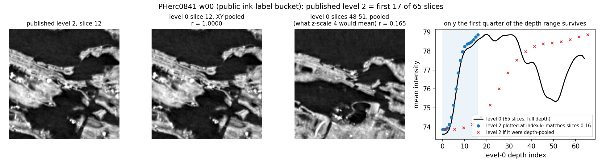
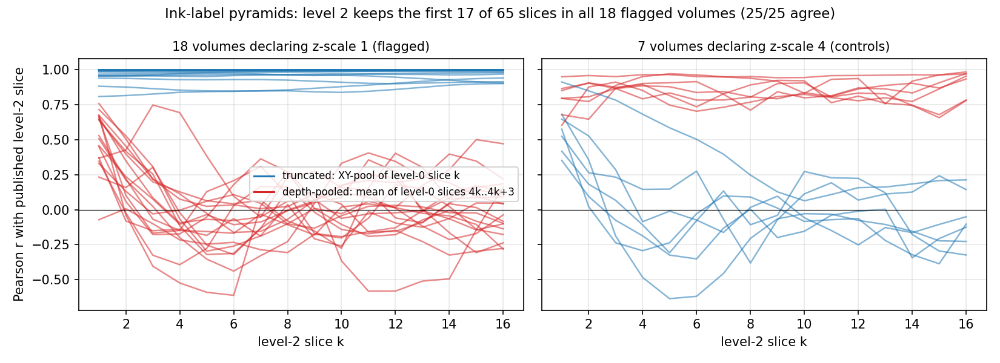
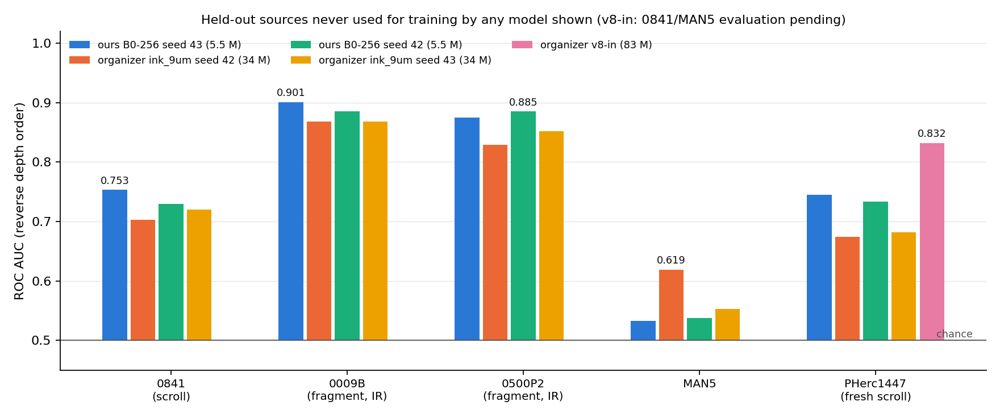
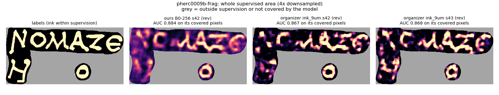
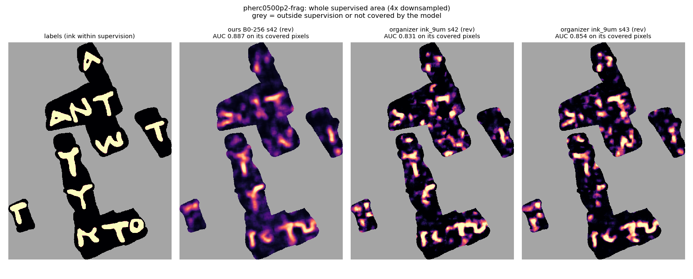
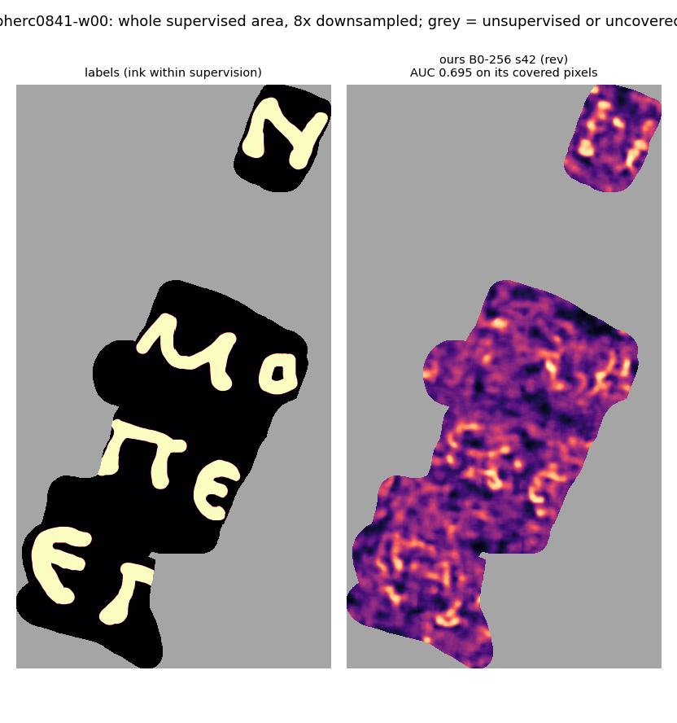
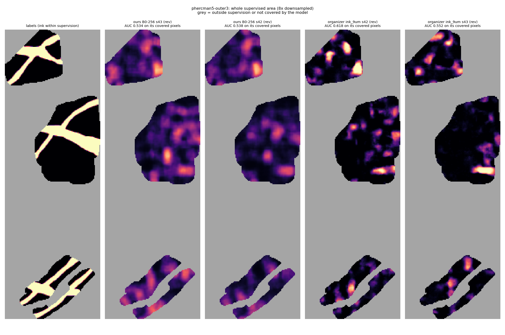
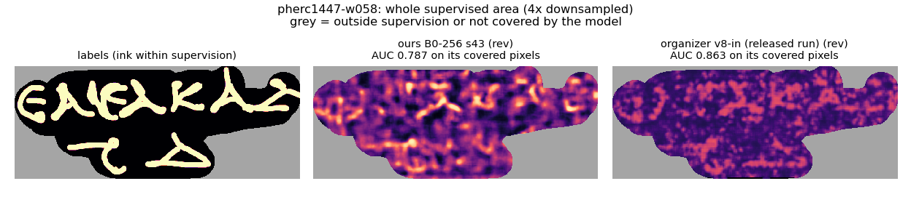

# Vesuvius ink detection across scrolls: a data bug, a fair benchmark, and a smaller model that generalizes

Work for the Vesuvius Challenge Progress Prize (October 2026). Three parts, in order of evidence strength:

1. **A depth bug in the public ink-label surface pyramids.** In 18 of the 33 volumes of the organizers' `ink/` bucket,
   levels 1–5 keep only the *first* slices of the 65-slice render instead of depth-pooling it, while their metadata
   still declares an unchanged z-scale. Pixel-verified on all 18, with the 7 correctly built volumes as negative
   controls (25/25 agree). It silently broke ink detection: the organizers' released `ink_9um` model scores
   0.54 AUC on its own training source fed the published level 2, and 0.91–0.93 after our rebuild.
2. **A held-out cross-scroll benchmark at verified physical scale**, scoring every model on identical pixels, with
   failure analyses: PHerc0841's 4.681 µm renders need 2× (not 4×) pooling; MAN5 fails for every model, and it is
   not misregistration, scale or depth.
3. **A small model** (B0-256, 5.5 M parameters) trained only on 0139, 1667, Paris4 and 0814, which beats the released
   `ink_9um` (34 M) on three of four sources neither model ever saw. It does not beat the organizers' newer `v8-in`
   on the fresh scroll PHerc1447.

## 1. The pyramid bug

| | Flagged volumes (declare z-scale 1) | Controls (declare z-scale 4) |
|---|---|---|
| Count | 18 | 7 (0139 w035–w044, MAN5) |
| Level-2 slice k matches XY-pooled level-0 slice k (median r) | **0.857–0.99999** | −0.17 to 0.23 |
| Level-2 slice k matches depth-pooled slices 4k..4k+3 (median r) | −0.16 to 0.20 | **0.80–0.96** |

Affected: 0009B, 0500P2, 0814, all three 0841, six 1667, 0139 w016/w017/w028/w029/w030, `unused/500p2a`.
Paris4 is unaffected (65 slices at every level). Reproduce: `python pyramid-repair/tools/verify_all_pyramids.py`.
Fix: rebuild inputs from level 0 with a pooling factor chosen from the render's *physical* voxel size
(`pyramid-repair/tools/pool_surface.py`). Details, evidence JSON and checksums: [`pyramid-repair/`](pyramid-repair/). The bug report as filed: [`pyramid-repair/BUG_REPORT.md`](pyramid-repair/BUG_REPORT.md).

## 2–3. Held-out benchmark (AUC, reverse depth order, identical pixels)

Training sources for our models: 0139, 1667, Paris4, 0814 (the same four scrolls `ink_9um` was trained on).
None of the test sources below was used for training by our models or by `ink_9um`.

| Model | Params | 0841 (scroll, 9.362 µm) | 0009B (fragment, IR labels) | 0500P2 (fragment, IR labels) | MAN5 |
|---|---:|---:|---:|---:|---:|
| ours B0-256 seed 43 | 5.5 M | **0.753** | **0.901** | 0.875 | 0.533 |
| ours B0-256 seed 42 | 5.5 M | 0.730 | 0.885 | **0.887** | 0.538 |
| ours V3 + DINOv3 ViT-S | ~25 M | 0.729 | 0.875 | 0.870 | 0.504 |
| organizer `ink_9um` seed 42 | 34 M | 0.703 | 0.868 | 0.831 | **0.617** |
| organizer `ink_9um` seed 43 | 34 M | 0.720 | 0.868 | 0.854 | 0.552 |

Whole-fragment predictions (no hand-picked crops; left to right: labels, ours, `ink_9um` s42, `ink_9um` s43):

Scroll 0841 is much harder (AUC ≈ 0.70–0.75 for everyone); its maps show stroke structure but no readable letters:

MAN5 is near chance for every model (diagnosis in `reports/MAN5_DIAGNOSIS_20261014.md`):

**Ensembles on identical pixels** (protocol frozen before scoring:
[`reports/FINAL_EVAL_PROTOCOL_20261014.md`](reports/FINAL_EVAL_PROTOCOL_20261014.md); raw output in `results/`):

| | 0841 | 0009B | 0500P2 | MAN5 | macro (primary) | pooled AUC | AP |
|---|---:|---:|---:|---:|---:|---:|---:|
| ours (B0 s42 + s43 + DINOv3) | **0.761** | **0.899** | **0.894** | 0.526 | 0.770 | **0.760** | **0.616** |
| `ink_9um` (s42 + s43) | 0.728 | 0.883 | 0.864 | **0.621** | **0.774** | 0.751 | 0.598 |

Ours wins three of four sources plus pooled AUC and AP, but on the predeclared primary statistic (macro over sources)
ours is 0.004 lower (0.770 vs 0.774), entirely because of MAN5.

**A fresh scroll, PHerc1447** (w058/w060; organizer release, unseen by our models, `ink_9um` and the `v8-in` base model).
Our scoring reproduces the publisher's own `v8-in` numbers exactly (0.862 / 0.810).

| | w058 | w060 | pooled AUC |
|---|---:|---:|---:|
| ours B0-256 s43 | 0.788 | 0.720 | 0.745 |
| ours B0-256 s42 | 0.775 | 0.723 | 0.733 |
| ours V3 + DINOv3 ViT-S | 0.731 | 0.660 | 0.690 |
| organizer `ink_9um` s43 | | | 0.682 |
| organizer `ink_9um` s42 | | | 0.674 |
| organizer `v8-in` (83 M, Oct 2026), released zero-shot run | **0.863** | **0.812** | **0.832** |

Our B0 beats `ink_9um` on this fresh scroll as well (+0.05 to +0.07), but the organizers' newest model is clearly
better here; our model claim is limited to the released `ink_9um`. **Negative result, reported as such:** we fine-tuned `v8-in` on our corrected training inventory under a protocol fixed
in advance ([`reports/V8IN_FINETUNE_PROTOCOL_20261014.md`](reports/V8IN_FINETUNE_PROTOCOL_20261014.md)). It improved
held-out training-store validation (0.804 -> 0.835) and PHerc1447 (0.777 -> 0.797 in our pipeline), but lost on 0841
(0.768 -> 0.755) and MAN5 (0.488 -> 0.442), so it does not beat `v8-in` (macro 0.665 vs 0.678). On identical pixels,
`v8-in` is also the best single model on 0841 (0.768; Reader v2 0.756, our B0 0.753).

Still running: `v8-in` on 0841 and MAN5 (both unseen by it), the `v8-in` fine-tune, and two U2-Net ablations (a 1.2 M-parameter U2-NetP and a 4.5 M U2-Net body on our 3D stem). The planned 30k-step B0 run was stopped after 12 h without completing; it produced no results.

## Honest limitations
- The four test sources informed our design choices (patch size, loss, backbone): they are held-out sources, not an
  untouched final test. PHerc1447 is added as a fresh one.
- MAN5 is a failure for every model ([`reports/MAN5_DIAGNOSIS_20261014.md`](reports/MAN5_DIAGNOSIS_20261014.md)).
- Prior work: the depth-direction dependence of `ink_9um` and a held-out evaluation on 0841 were published first by
  Andreas Hadjigeorgiou (ScrollPrize/villa#1867); the depth window study by Paulo Camillo. We build on both.

## Layout
- `pyramid-repair/`: bug report, evidence, survey/verify/rebuild tools.
- `ink/`: trainer (`train_v2.py`), data preparation (`prep/`), evaluation and identical-pixel scoring (`eval/`),
  Kaggle helpers (`kaggle/`), MAN5 diagnostics (`analysis/man5/`).
- `vc-multiscan/`: multi-resolution scan registration and tifxyz rendering tools.
- `reports/`: experiment log, audits and protocols. `docs/`: figures and the scripts that make them.

Data are not redistributed; everything is read from the public Vesuvius Challenge buckets. Code is MIT-licensed
(`LICENSE`); figures derived from Vesuvius Challenge scans follow the data's CC BY-NC terms.

## Open problems this addresses
- Cross-scroll generalization (scrollprize.org 2026 open problems): a reproducible identical-pixel benchmark over five
  never-trained-on sources, including the organizers' newest model.
- Label and data quality: a silent depth defect in the public ink-label pyramids, with pixel evidence and a fix; a
  diagnosis of why MAN5 fails for every model.
